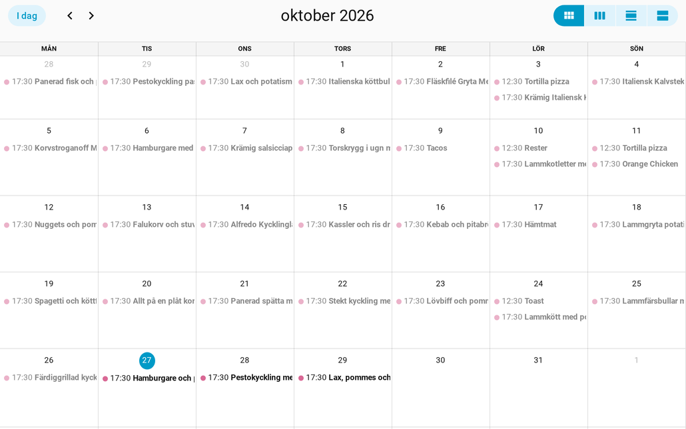
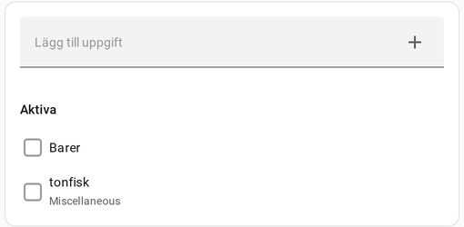
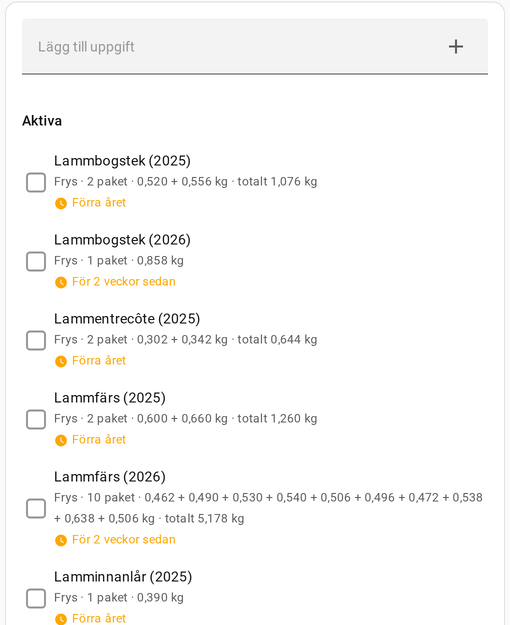

# Paprika för Home Assistant

Inofficiell integration som kopplar [Paprika Recipe Manager 3](https://www.paprikaapp.com/) till Home Assistant via Paprikas molnsynk.

*In English: unofficial Home Assistant integration for Paprika Recipe Manager 3. Adds the meal plan as a calendar, the grocery list and pantry as editable to-do lists, sensors, and services to search, read, create and update recipes.*

## Funktioner

| Entitet / tjänst | Vad den gör |
|---|---|
| `calendar.paprika_meal_plan` | Måltidsplanen som kalender. Lunch läggs kl. 12.30, middag kl. 17.30 och övriga måltidstyper på tiden som är inställd i Paprika. Varje händelse är en timme. |
| `todo.paprika_groceries` | Inköpslistan. Lägg till, byt namn och bocka av. |
| `todo.paprika_pantry` | Köksskåpet. Lägg till, ändra, bocka av (slut) och ta bort. Beskrivningen är mängd och förfallodatumet är bäst före-datum. |
| Sensor Next Meal | Nästa planerade måltid, med datum, måltidstyp och recept som attribut. |
| Sensor Meal Count Today | Antal måltider i dag, med dagens måltider som attribut. |
| Sensor Grocery Items | Antal varor kvar på inköpslistan, med varorna som attribut. |
| Sensor Recipe Total | Antal recept, utan dem i papperskorgen. |
| Sensor Recipe Preview | De 15 senast tillagda recepten som attribut (namn, kategorier, bild). |
| `paprika.search_recipes` | Söker recept på namn och valfritt ingredienser. Returnerar en kort lista. |
| `paprika.get_recipe` | Returnerar ett helt recept med ingredienser och instruktioner. |
| `paprika.create_recipe` | Skapar ett recept. |
| `paprika.update_recipe` | Ändrar de angivna fälten i ett recept. |

<p>
  
</p>
<p>
  
  
</p>

Ändringar från HA skickas till Paprika direkt, och apparna ombeds synka. Data hämtas från Paprika var 30:e minut (går att ställa mellan 5 och 180 minuter).

## Krav

- Home Assistant 2024.11 eller senare.
- Ett Paprika-konto med Cloud Sync (e-post och lösenord).

## Installation

[](https://my.home-assistant.io/redirect/hacs_repository/?owner=pwassvik-png&repository=paprika-ha&category=integration)

HACS: tryck på knappen ovan, eller lägg till `https://github.com/pwassvik-png/paprika-ha` som anpassat förråd av typen *Integration*, installera *Paprika Recipe Manager* och starta om Home Assistant.

Manuellt: kopiera `custom_components/paprika/` till `config/custom_components/` och starta om Home Assistant.

## Konfiguration

1. Inställningar → Enheter och tjänster → Lägg till integration → Paprika.
2. Ange e-post och lösenord för Paprika Cloud Sync. Inloggningen kontrolleras innan integrationen sparas.

Uppdateringsintervallet ändras under integrationens inställningar. Lösenordet byts via ⋮ → *Konfigurera om*. Om Paprika slutar godta lösenordet ber Home Assistant om ett nytt.

## Recepttjänster

Sök- och hämttjänsterna returnerar data och används med `response_variable`.

```yaml
- action: paprika.search_recipes
  data:
    query: kyckling
    limit: 5
  response_variable: hits
- action: paprika.get_recipe
  data:
    recipe: "{{ hits.recipes[0].uid }}"
  response_variable: recept
```

- `recipe` kan vara uid, hela namnet eller en del av namnet som bara matchar ett recept.
- `ingredients` och `directions` anges som text med en rad per post, eller som lista.
- `categories` anges med namn på kategorier som finns i Paprika.
- Recept i papperskorgen tas bara med i sökningen med `include_trash: true`.

Alla fält beskrivs under Utvecklarverktyg → Åtgärder.

## Begränsningar

- Paprikas API är inte dokumenterat och kan ändras. Integrationen identifierar sig som Paprikas Mac-app, eftersom API:t bara svarar sådana klienter.
- Varor kan inte tas bort från inköpslistan via API:t. Att ta bort en vara i HA bockar av den.
- Köksskåpets platser stöds inte.
- Recept kan inte tas bort, foton stöds inte och nya kategorier kan inte skapas.
- Paprika svarar 429 vid för många anrop på kort tid, till exempel flera omstarter i rad. Integrationen startar då först efter ungefär tio minuter. Recepten cachas på disk för att undvika detta.

## Utveckling

Tester: `for t in tests/test_api.py tests/test_recipes.py tests/test_todo_compatibility.py; do python3 "$t"; done`. Anteckningar om Paprikas API finns i [docs/API.md](docs/API.md) och ändringar i [CHANGELOG.md](CHANGELOG.md).

## Licens

MIT, se [LICENSE](LICENSE). Projektet har ingen koppling till Hindsight Labs.
